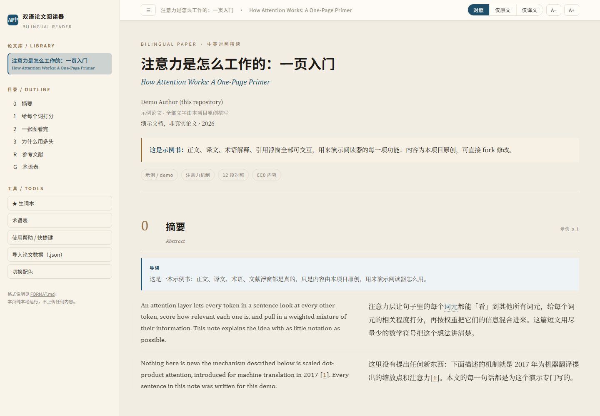
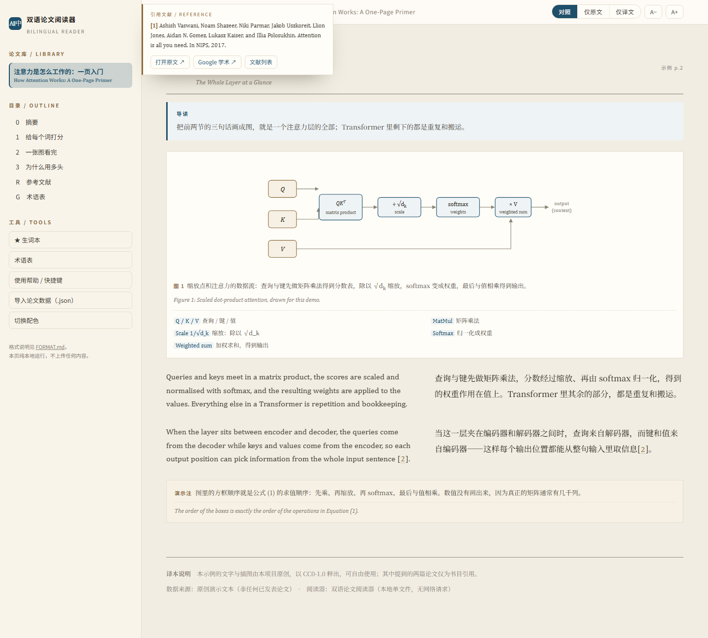

# 双语论文阅读器 / Bilingual Paper Reader

左边英文原文、右边中文译文，**逐句对齐**的论文阅读器。悬停看对照，术语悬停出解释，
引用编号悬停出文献小窗。纯静态网页，双击即用，不联网、不传服务器。

仓库里只有**工具**和一篇**原创示例论文**——不带任何已发表论文的正文与译文（原因见
[NOTICE.md](NOTICE.md)）。你可以把自己的 PDF 变成一本书，只放在自己电脑上。

在线试试：**https://qzy033.github.io/bilingual-paper-reader/**



## 亮眼的地方

- **三种视图**：对照 / 仅原文 / 仅译文（`1` `2` `3`）。
- **悬停对照**：对照模式悬停左栏，右栏同段高亮；仅原文模式悬停，直接浮出译文卡片。
- **术语解释**：虚线下划线，悬停出卡片（先打比方、再给定义）；**点击**会在原文里高亮对应的英文词。
- **引用浮窗**：正文 `[13]`、`[38, 24, 15]` 在中英两栏都会变成链接，悬停出文献卡片，可一键打开 arXiv。
- **生词本**：跨篇保存，可导出 Markdown。
- **读起来舒服**：字号调节、米白 / 羊皮纸 / 夜间三套配色、自动记住读到哪。
- **可打印**：Chrome 直接打印就是 A4 双栏对照 PDF。



## 快速开始

```bash
git clone <this-repo> && cd bilingual-paper-reader
# 双击 reader/index.html 即可
```

第一次打开看到的是示例论文《注意力是怎么工作的：一页入门》——文字、插图、术语、引用
全部为本项目原创，用来演示每个功能。

## 把自己的论文做成一本

一条命令（Windows / macOS / Linux 都行）：

```powershell
# Windows
$env:OPENAI_API_KEY="sk-..."          # 任何 OpenAI 兼容端点，可用 OPENAI_BASE_URL / MODEL 覆盖
.\make.ps1 -Pdf "C:\papers\some-paper.pdf" -Slug my-paper -Package
```

```bash
# macOS / Linux
export OPENAI_API_KEY=sk-...
./make.sh ~/papers/some-paper.pdf my-paper --package
```

脚本做四件事：`pdf_to_json.py` 抽文本分节 → `translate.py` 逐段翻译并生成术语表 →
`build_paper.py` 构建 → `package.py` 打 zip。想自己译就加 `-NoTranslate`。

只跑其中一步也行：

```bash
python tools/pdf_to_json.py paper.pdf my-paper     # 1. 抽文本、自动分节
python tools/translate.py --slug my-paper --with-terms   # 2. 自动翻译（可 --dry-run 先看量）
python build_paper.py                              # 3. 打包进阅读器
python tools/package.py                            # 4. 打成可分发的 zip
```

刷新 `reader/index.html`，左侧「论文库」里就多了一本。
数据格式、块类型、术语与引用的写法、给 AI 的续写提示词，全在
[`reader/FORMAT.md`](reader/FORMAT.md)。

> 也可以把单篇 JSON 直接**拖进浏览器窗口**，不入库、不落盘。

## 目录

```
reader/index.html          阅读器（样式 + 渲染 + 交互，单文件）
reader/FORMAT.md           数据格式说明（给人，也给 AI）
reader/papers/library.js   构建产物：论文数据（自动生成）
reader/assets/<id>/        构建产物：插图
data/demo/                 示例论文源数据
tools/pdf_to_json.py       PDF → 待翻译骨架
build_paper.py             构建 + 格式校验
docs/                      截图
```

## 设计上的取舍

- **不做在线翻译**：译文由你（或你的 AI 助手）离线写好再灌进来，所以没有 API key、
  没有网络请求、不会把你正在读的论文发给别人。
- **一处数据、三种呈现**：同一份 JSON 既能屏幕阅读，也能打印 A4，还能被搜索。
- **术语与引用都要"指得回去"**：术语点一下就定位到原文英文，引用点一下就跳到文献条目。

## 许可

- **代码**：MIT，见 [LICENSE](LICENSE)。
- **示例论文的文字与插图**：CC0-1.0（公有领域贡献），随便用。
- **第三方内容**：仓库不包含任何第三方论文全文；引用条目仅为书目信息。详见 [NOTICE.md](NOTICE.md)。

## English

A dependency-free bilingual reader for papers: original on the left, translation on the right,
sentence by sentence. Hover a paragraph to see its counterpart, hover a term for a plain-language
explanation, hover a citation for a reference popover. Everything is a static file — open
`reader/index.html`, no server needed.

The repository ships the **tool** plus one **original demo paper** (CC0). No published paper's
text is bundled: see [NOTICE.md](NOTICE.md). To read your own paper, extract it with
`tools/pdf_to_json.py`, fill in the translation, and run `build_paper.py`.
